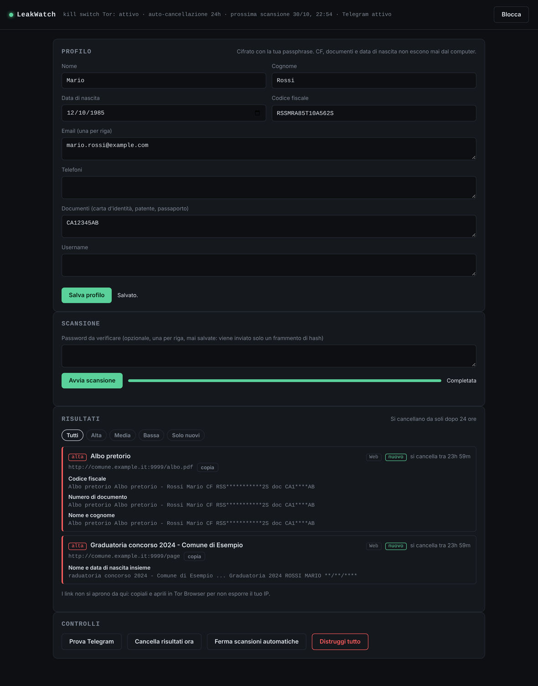
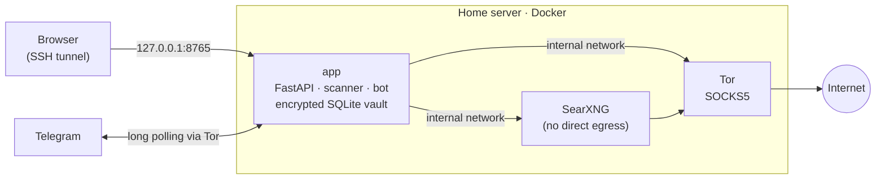
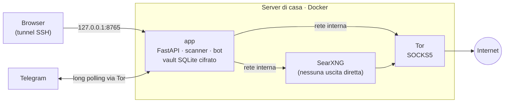

<div align="center">

# LeakWatch

**Self-hosted personal data leak monitor · Monitor self-hosted dei leak di dati personali**

[](https://github.com/TexAlphaWolf/leakwatch/actions/workflows/ci.yml)


🇬🇧 [**English**](#english) · 🇮🇹 [**Italiano**](#italiano)



</div>

---

<a id="english"></a>

## 🇬🇧 English

**LeakWatch** checks whether **your own** personal data has leaked, either in data breaches or on public web pages. It is built to run 24/7 on a home server.

It covers:

- email, phone, name and date of birth;
- Italian tax code (*codice fiscale*) and ID document numbers;
- passwords.

The privacy guarantees:

- **Sensitive data never leaves the server.** The tax code, document numbers and date of birth are never sent to anyone: candidate pages are downloaded and matched **locally, in memory**.
- **All outbound traffic goes through Tor**, with a kill switch.
- **Encrypted, then deleted.** Everything lives in an encrypted vault, and results delete themselves after 24 hours.
- **Daily Telegram report** that contains no personal data.
- **Free and AI-free.** Fully deterministic algorithms and no paid APIs.

> ⚠️ Intended only for monitoring your own data. Searching other people's personal data without consent is unlawful processing under the GDPR.

### Features

- **Breach checks**
  - Pwned Passwords, using k-anonymity: only 5 hex characters of the SHA-1 hash are sent.
  - LeakCheck public API, queried with a truncated SHA-256 of the email instead of the email itself.
- **Web exposure search** through a private SearXNG instance that reaches the internet only via Tor.
  - HTML and PDF pages are downloaded in memory and scanned locally.
- **Deterministic matching, no AI**
  - tax-code validation, including the check character and *omocodia* variants;
  - phone normalization and date-format variants;
  - name matching with Levenshtein distance.
- **Severity scoring.** A name alone is *low*. A name next to the date of birth, a tax code or a document number is *high*.
- **Novelty detection.** Only HMAC fingerprints are kept, never the content, so you are alerted only about new findings.
- **Daily scheduled scan**
  - randomized start time (±90 min);
  - retries when Tor is down;
  - startup notification after a reboot.
- **Telegram bot**
  - Commands: `/stato`, `/scansiona`, `/pulisci`, `/panico` (lockdown).
  - It only obeys your chat ID.
  - Messages cannot be forwarded and are auto-deleted after 24 h.
- **Minimal dashboard**
  - No external resources and a strict CSP.
  - DNS-rebinding and CSRF protection, and HttpOnly/SameSite sessions.
  - All web content is rendered as text, so injected HTML cannot run (no XSS).

### Architecture



| Container | Networks | Internet access |
|---|---|---|
| `tor` | internal + egress | The only container with direct egress |
| `searxng` | internal only | None directly: only through Tor |
| `app` | internal + frontend | All external requests use the Tor proxy (`trust_env=False`). The kill switch checks `IsTor` before every scan. |

### What leaves the server, and what doesn't

| Data | Used by | What the external service sees |
|---|---|---|
| Password | Pwned Passwords | First 5 chars of the SHA-1 hash, with a padded response |
| Email | LeakCheck | SHA-256 of the email, truncated to 24 chars (`LW_LEAKCHECK_HASHED`) |
| Email | Web search via Tor | The email. Can be disabled with `LW_WEB_SEARCH_EMAIL=false` |
| First and last name | Web search via Tor | The name |
| Phone | Web search | Disabled by default (`LW_WEB_SEARCH_PHONE`) |
| **Tax code, documents, date of birth** | **Nowhere** | Nothing: pages are fetched into RAM and matched locally |

### Local protections and engineering highlights

- **Encrypted vault**
  - Key derived from the passphrase with scrypt (N=2¹⁵); each record is encrypted with Fernet (AES-CBC + HMAC).
  - The key lives only in RAM.
- **Vault and UI are separated.** The scheduler keeps the key in memory for unattended scans, but the dashboard still asks for the passphrase every session (30-minute idle timeout). A wrong passphrase never drops the running key.
- **Automatic deletion**
  - Results and searches are deleted after `LW_RETENTION_HOURS` (24 h).
  - SQLite runs with `secure_delete`, followed by `VACUUM`.
  - Only non-reversible HMAC fingerprints remain, for `LW_FINGERPRINT_DAYS` (30 days; 0 = none).
- **Nothing on disk**
  - Pages and PDFs are processed in memory.
  - No log contains personal data, and the access log is off.
  - Tor state and the SearXNG cache live on tmpfs.
- **No IP leaks from links.** Links to findings are copy-only, so you open them in Tor Browser instead of exposing your IP.
- **SSRF protection.** A page found online cannot make LeakWatch reach your home network: requests and redirects to private IPs, `localhost`, `.lan`/`.local` names and bare hostnames are blocked.
- **Brute-force protection.** Unlock attempts are processed one at a time with a growing delay (up to 30 s), and the bot warns you after 5 and 20 failed attempts in a row.
- **Sessions expire for real.** Background status polling never extends a session, and when it expires the page wipes every value from the DOM.
- **Hardened containers**
  - Read-only root filesystems, `cap_drop: ALL` and `no-new-privileges`.
  - Memory, CPU and PID limits, and Docker logs capped at 2 × 1 MB.
- **Privacy is tested.** The tests assert that the tax code, document number and date of birth never appear in outgoing queries, that LeakCheck receives only the email hash, and that no personal data at all appears in Telegram reports.
- **CI on every push**
  - Ruff lint and format, pytest (46 tests), ShellCheck, `docker compose config` and image builds.
  - Dependabot keeps pip, Docker and Actions dependencies updated.

See [docs/THREAT_MODEL.md](docs/THREAT_MODEL.md) for the threat model.

### Telegram bot

**Setup**

1. On Telegram, message **@BotFather**, send `/newbot` and copy the token.
2. Send any message to your new bot.
3. Get your chat ID: open `https://api.telegram.org/bot<TOKEN>/getUpdates` in Tor Browser and copy `message.chat.id`.
4. Put the token and chat ID in `.env` (`./leakwatch.sh install` asks for them).
5. Press **Prova Telegram** in the dashboard.

**What reaches Telegram**

Bot messages are **not end-to-end encrypted**, so a report contains only:

- the number of new findings per severity;
- the page domain or the breach name;
- the *type* of data found, for example "Codice fiscale".

It never contains the tax code, document number, date of birth, email, phone, name or text snippets.

In addition:

- Messages are sent with `protect_content`, so they cannot be forwarded or saved.
- They are deleted after 24 h, together with your commands.
- All calls to Telegram go through Tor.
- The bot uses long polling, so no port is exposed.

**Commands.** The bot answers only the configured chat ID; anyone else is silently ignored.

| Command | Action |
|---|---|
| `/stato` | Vault state, next scan, active findings per severity |
| `/scansiona` | Start a scan now |
| `/pulisci` | Delete findings and search history |
| `/panico` | Lockdown: key dropped from RAM, sessions closed, scans stopped, chat wiped |
| `/aiuto` | List of commands |

The passphrase is never sent over Telegram: unlocking happens only in the dashboard.

### Installation on a home server (24/7)

Requirements: Linux with Docker Engine and Compose v2 (x86_64 or ARM64).

```bash
git clone https://github.com/TexAlphaWolf/leakwatch.git
cd leakwatch
./leakwatch.sh install
```

The installer:

- generates the SearXNG secret and asks for the bot token (hidden input) and your chat ID;
- stores them in `.env` with mode `600`;
- enables Docker at boot and starts the three containers;
- warns if the disk is not LUKS-encrypted.

The dashboard listens **only** on the server's `127.0.0.1` and is not exposed to your home network. Open it from your PC through an SSH tunnel:

```bash
ssh -N -L 8765:127.0.0.1:8765 user@SERVER_IP
# then browse to http://127.0.0.1:8765
```

Then:

1. Create the vault.
2. Fill in your profile.
3. Press **Prova Telegram** to check the bot.

The first automatic scan starts about 5 minutes later and then repeats every 24 h. From then on you can close the tunnel and use the bot from your phone.

**Management**

| Command | Description |
|---|---|
| `./leakwatch.sh status` | Container health, vault state, next scan |
| `./leakwatch.sh logs [app\|tor\|searxng]` | Recent logs (never contain personal data) |
| `./leakwatch.sh start` / `stop` / `restart` | Container control |
| `./leakwatch.sh update` | Pull and rebuild images |
| `./leakwatch.sh autounlock on\|off` | Unlock automatically after reboots |
| `./leakwatch.sh tunnel` | Print the SSH tunnel command |
| `./leakwatch.sh uninstall` | Remove everything, including the vault |

**What happens when…**

| Event | Behaviour |
|---|---|
| A container crashes | Docker restarts it (`restart: unless-stopped`). Healthchecks run every minute. |
| The server reboots | Containers come back up and the bot sends "LeakWatch avviato". If the vault is locked, it asks you to unlock it. |
| Tor can't reach the network | The scan is retried every 15 min, up to 6 times. Nothing is ever sent in clear. |
| You're away from home | Use `/stato` and `/scansiona` from the bot. Unlocking needs the SSH tunnel (e.g. Termux on your phone). |

**Resources**

| Container | RAM limit | CPU limit |
|---|---|---|
| app | 512 MB | 1 core |
| searxng | 512 MB | 1 core |
| tor | 256 MB | 0.5 core |

Idle usage is much lower; the limits just keep it from disturbing other services on the server.

**Auto-unlock.** `./leakwatch.sh autounlock on` stores the passphrase in `secrets/lw_passphrase.txt`, readable only by the container user, and mounts it as a Docker secret. The vault then unlocks by itself after a reboot. It is convenient, but whoever gets the disk gets the vault: use it only with full-disk encryption. `autounlock off` shreds the file.

### Running without Docker

You need Tor on `127.0.0.1:9050` and, for web search, a SearXNG instance with the `json` format enabled.

```bash
cd app
python -m venv .venv && source .venv/bin/activate
pip install -r requirements.txt
LW_SEARXNG_URL=http://127.0.0.1:8888 python -m leakwatch
```

### Configuration

| Variable | Default | Description |
|---|---|---|
| `LW_REQUIRE_TOR` | `true` | Kill switch: no request leaves without Tor |
| `LW_RETENTION_HOURS` | `24` | Lifetime of findings, searches and Telegram messages |
| `LW_FINGERPRINT_DAYS` | `30` | Lifetime of HMAC fingerprints (0 = none) |
| `LW_STORE_PROFILE` | `true` | Store the profile encrypted; `false` keeps it in RAM only |
| `LW_AUTO_LOCK_MINUTES` | `30` | Dashboard session timeout (also locks the vault when the scheduler is off) |
| `LW_AUTO_SCAN_HOURS` | `24` in compose, `0` otherwise | Scan interval (0 = manual only) |
| `LW_AUTO_SCAN_JITTER_MINUTES` | `90` | Random variation of the scan time |
| `LW_UNLOCK_KEYFILE` | — | Passphrase file for auto-unlock |
| `LW_TELEGRAM_TOKEN` | — | Bot token |
| `LW_TELEGRAM_CHAT_ID` | — | The only authorized chat ID |
| `LW_TELEGRAM_QUIET` | `false` | `true` = message only on new findings or errors |
| `LW_TELEGRAM_COMMANDS` | `true` | Enable bot commands |
| `LW_MAX_PAGES` | `25` | Pages analysed per scan |
| `LW_WEB_SEARCH_EMAIL` | `true` | Search the email on the web |
| `LW_WEB_SEARCH_PHONE` | `false` | Search the phone number on the web |
| `LW_LEAKCHECK_HASHED` | `true` | Send LeakCheck the hash instead of the email |
| `LW_ALLOW_PRIVATE_URLS` | `false` | Allow private destinations (local testing only) |

### Development

```bash
cd app
pip install -r requirements.txt -r requirements-dev.txt
ruff check leakwatch tests && ruff format --check leakwatch tests
pytest -v
```

```
app/leakwatch/
  normalize.py   tax-code checksum, phone/date normalization, Levenshtein
  matcher.py     local matching and snippet masking
  vault.py       encrypted storage, retention, fingerprints
  scanner.py     scan orchestration
  sources/       Pwned Passwords, LeakCheck, SearXNG + page extraction
  telegram.py    bot, privacy-safe reports, auto-deletion
  main.py        FastAPI app, sessions, scheduler, security middleware
  static/        dashboard (vanilla JS, no CDN)
app/tests/
  test_core.py        tax code, normalization, matching, vault and retention
  test_api.py         Host/CSRF/Origin checks, sessions, path traversal, wipe
  test_scanner.py     end-to-end scan with simulated sources, privacy of queries and reports
  test_hardening.py   PDF extraction, SSRF, Tor kill switch, malformed input, brute force
```

### Known limitations

- **Tor and external services**
  - Some services block or throttle Tor exits. Google in particular shows captchas, so SearXNG falls back to other engines.
  - The public LeakCheck API has limited coverage and does not say exactly which data leaked.
- **Partial coverage.** Closed forums, Telegram channels and unindexed dumps are not covered, by design: downloading them would be illegal and dangerous.
- **Memory and disk**
  - Python cannot guarantee that secrets are wiped from memory.
  - SSD wear-levelling may keep overwritten blocks.
  - Use full-disk encryption (LUKS).
- **Name matching** accepts first and last name in either order, adjacent or with a middle name between them, with one typo for words of 5+ letters. People with the same name produce *low* severity results; severity rises only when the date of birth, tax code or a document appears nearby.

---

<a id="italiano"></a>

## 🇮🇹 Italiano

**LeakWatch** controlla se i **tuoi** dati personali sono finiti in data breach o sono esposti su pagine web pubbliche. È pensato per girare 24/7 su un server di casa.

Copre:

- email, telefono, nome e data di nascita;
- codice fiscale e numeri dei documenti d'identità;
- password.

Le garanzie di privacy:

- **I dati sensibili non lasciano mai il server.** Codice fiscale, documenti e data di nascita non vengono mai inviati a nessuno: le pagine trovate si scaricano e si confrontano **in locale, in memoria**.
- **Tutto il traffico in uscita passa da Tor**, con un kill switch.
- **Cifrato, poi cancellato.** Tutto sta in un vault cifrato e i risultati si cancellano da soli dopo 24 ore.
- **Report giornaliero su Telegram**, senza nessun dato personale.
- **Gratuito e senza IA.** Algoritmi completamente deterministici, nessuna API a pagamento.

> ⚠️ Da usare solo per i propri dati. Cercare dati personali di altre persone senza il loro consenso è un trattamento illecito secondo il GDPR.

### Funzionalità

- **Controllo dei breach**
  - Pwned Passwords con k-anonymity: si inviano solo 5 caratteri dell'hash SHA-1.
  - API pubblica di LeakCheck, interrogata con lo SHA-256 troncato dell'email invece dell'email stessa.
- **Ricerca di esposizioni sul web** tramite un'istanza SearXNG privata, che raggiunge Internet solo via Tor.
  - Pagine HTML e PDF vengono scaricate in memoria e analizzate in locale.
- **Confronto deterministico, senza IA**
  - validazione del codice fiscale, compresi carattere di controllo e varianti con omocodia;
  - normalizzazione dei telefoni e varianti di formato delle date;
  - riconoscimento del nome con la distanza di Levenshtein.
- **Livelli di gravità.** Il solo nome ha gravità *bassa*. Il nome vicino a data di nascita, codice fiscale o documento ha gravità *alta*.
- **Riconoscimento delle novità.** Restano solo impronte HMAC, mai il contenuto, così ricevi avvisi solo per i risultati nuovi.
- **Scansione automatica giornaliera**
  - orario variabile (±90 minuti);
  - nuovi tentativi se Tor non risponde;
  - avviso di avvio dopo un riavvio.
- **Bot Telegram**
  - Comandi: `/stato`, `/scansiona`, `/pulisci`, `/panico` (lockdown).
  - Risponde solo al tuo chat ID.
  - I messaggi non si possono inoltrare e si cancellano dopo 24 ore.
- **Dashboard minimale**
  - Nessuna risorsa esterna e una CSP restrittiva.
  - Protezione da DNS rebinding e CSRF, e sessioni HttpOnly/SameSite.
  - Il contenuto delle pagine trovate è mostrato solo come testo, quindi non può eseguire codice (niente XSS).

### Architettura



| Container | Reti | Accesso a Internet |
|---|---|---|
| `tor` | internal + egress | Unico container con uscita diretta |
| `searxng` | solo internal | Nessuno diretto: solo via Tor |
| `app` | internal + frontend | Tutte le richieste esterne usano il proxy Tor (`trust_env=False`). Il kill switch verifica `IsTor` prima di ogni scansione. |

### Cosa esce dal server e cosa no

| Dato | Dove viene usato | Cosa vede il servizio esterno |
|---|---|---|
| Password | Pwned Passwords | I primi 5 caratteri dell'hash SHA-1, con risposta a lunghezza costante |
| Email | LeakCheck | SHA-256 dell'email troncato a 24 caratteri (`LW_LEAKCHECK_HASHED`) |
| Email | Ricerca web via Tor | L'email. Disattivabile con `LW_WEB_SEARCH_EMAIL=false` |
| Nome e cognome | Ricerca web via Tor | Il nome |
| Telefono | Ricerca web | Disattivata di default (`LW_WEB_SEARCH_PHONE`) |
| **Codice fiscale, documenti, data di nascita** | **Da nessuna parte** | Nulla: le pagine si scaricano in RAM e si confrontano in locale |

### Protezioni locali e scelte tecniche

- **Vault cifrato**
  - Chiave derivata dalla passphrase con scrypt (N=2¹⁵); ogni record è cifrato con Fernet (AES-CBC + HMAC).
  - La chiave vive solo in RAM.
- **Vault e interfaccia sono separati.** Lo scheduler tiene la chiave in memoria per le scansioni automatiche, ma la dashboard chiede comunque la passphrase a ogni sessione (scadenza dopo 30 minuti di inattività). Una passphrase sbagliata non fa mai perdere la chiave in uso.
- **Cancellazione automatica**
  - Risultati e ricerche vengono eliminati dopo `LW_RETENTION_HOURS` (24 ore).
  - SQLite usa `secure_delete`, seguito da `VACUUM`.
  - Restano solo impronte HMAC non reversibili, per `LW_FINGERPRINT_DAYS` (30 giorni; 0 = nessuna).
- **Niente su disco**
  - Pagine e PDF vengono elaborati in memoria.
  - Nessun log contiene dati personali e l'access log è disattivato.
  - Lo stato di Tor e la cache di SearXNG stanno su tmpfs.
- **Nessuna fuga di IP dai link.** I link ai risultati si possono solo copiare, così li apri in Tor Browser invece di esporre il tuo IP.
- **Protezione SSRF.** Una pagina trovata online non può far raggiungere a LeakWatch la tua rete di casa: richieste e redirect verso IP privati, `localhost`, nomi `.lan`/`.local` e nomi senza dominio vengono bloccati.
- **Protezione dai tentativi a forza bruta.** I tentativi di sblocco vengono elaborati uno alla volta con un ritardo crescente (fino a 30 s), e il bot ti avvisa dopo 5 e 20 tentativi falliti di fila.
- **Le sessioni scadono davvero.** Il controllo periodico dello stato non prolunga mai la sessione e, alla scadenza, la pagina cancella ogni valore dal DOM.
- **Container blindati**
  - Filesystem in sola lettura, `cap_drop: ALL` e `no-new-privileges`.
  - Limiti di memoria, CPU e processi, e log di Docker limitati a 2 × 1 MB.
- **La privacy è testata.** I test verificano che codice fiscale, documento e data di nascita non compaiano mai nelle richieste esterne, che a LeakCheck arrivi solo l'hash dell'email e che nei report Telegram non ci sia nessun dato personale.
- **CI a ogni push**
  - Ruff (lint e formattazione), pytest (46 test), ShellCheck, `docker compose config` e build delle immagini.
  - Dependabot tiene aggiornate le dipendenze pip, Docker e Actions.

Il modello delle minacce è in [docs/THREAT_MODEL.md](docs/THREAT_MODEL.md).

### Bot Telegram

**Configurazione**

1. Su Telegram scrivi a **@BotFather**, invia `/newbot` e copia il token.
2. Manda un messaggio qualsiasi al tuo nuovo bot.
3. Trova il tuo chat ID: apri `https://api.telegram.org/bot<TOKEN>/getUpdates` in Tor Browser e copia `message.chat.id`.
4. Inserisci token e chat ID in `.env` (`./leakwatch.sh install` te li chiede).
5. Premi **Prova Telegram** nella dashboard.

**Cosa arriva su Telegram**

I messaggi dei bot **non sono cifrati end-to-end**, quindi un report contiene solo:

- il numero di nuovi risultati per gravità;
- il dominio della pagina o il nome del breach;
- il *tipo* di dato trovato, per esempio "Codice fiscale".

Non contiene mai codice fiscale, numero di documento, data di nascita, email, telefono, nome o estratti di testo.

Inoltre:

- I messaggi sono inviati con `protect_content`, quindi non si possono inoltrare né salvare.
- Vengono cancellati dopo 24 ore, insieme ai tuoi comandi.
- Tutte le chiamate a Telegram passano da Tor.
- Il bot usa il long polling, quindi nessuna porta viene esposta.

**Comandi.** Il bot risponde solo al chat ID configurato; tutti gli altri vengono ignorati in silenzio.

| Comando | Azione |
|---|---|
| `/stato` | Stato del vault, prossima scansione, risultati attivi per gravità |
| `/scansiona` | Avvia subito una scansione |
| `/pulisci` | Cancella risultati e storico delle ricerche |
| `/panico` | Lockdown: chiave fuori dalla RAM, sessioni chiuse, scansioni ferme, chat cancellata |
| `/aiuto` | Elenco dei comandi |

La passphrase non si invia mai via Telegram: lo sblocco si fa solo dalla dashboard.

### Installazione sul server di casa (24/7)

Requisiti: Linux con Docker Engine e Compose v2 (x86_64 o ARM64).

```bash
git clone https://github.com/TexAlphaWolf/leakwatch.git
cd leakwatch
./leakwatch.sh install
```

Lo script di installazione:

- genera la chiave di SearXNG e chiede token del bot (senza mostrarlo mentre lo scrivi) e chat ID;
- li salva in `.env` con permessi `600`;
- abilita Docker all'avvio e avvia i tre container;
- avvisa se il disco non è cifrato con LUKS.

La dashboard ascolta **solo** su `127.0.0.1` del server e non è esposta sulla rete di casa. Aprila dal PC con un tunnel SSH:

```bash
ssh -N -L 8765:127.0.0.1:8765 utente@IP_DEL_SERVER
# poi apri http://127.0.0.1:8765 nel browser
```

Poi:

1. Crea il vault.
2. Compila il profilo.
3. Premi **Prova Telegram** per verificare il bot.

La prima scansione automatica parte circa 5 minuti dopo, poi si ripete ogni 24 ore. Da quel momento puoi chiudere il tunnel e usare il bot dal telefono.

**Gestione**

| Comando | Cosa fa |
|---|---|
| `./leakwatch.sh status` | Stato dei container e del vault, prossima scansione |
| `./leakwatch.sh logs [app\|tor\|searxng]` | Log recenti (non contengono mai dati personali) |
| `./leakwatch.sh start` / `stop` / `restart` | Controllo dei container |
| `./leakwatch.sh update` | Aggiorna e ricostruisce le immagini |
| `./leakwatch.sh autounlock on\|off` | Sblocco automatico dopo i riavvii |
| `./leakwatch.sh tunnel` | Mostra il comando per il tunnel SSH |
| `./leakwatch.sh uninstall` | Rimuove tutto, vault compreso |

**Cosa succede quando…**

| Evento | Comportamento |
|---|---|
| Un container va in crash | Docker lo riavvia (`restart: unless-stopped`). Gli healthcheck girano ogni minuto. |
| Il server si riavvia | I container ripartono e il bot scrive "LeakWatch avviato". Se il vault è bloccato, ti chiede di sbloccarlo. |
| Tor non raggiunge la rete | La scansione viene ritentata ogni 15 minuti, fino a 6 volte. Nulla viene mai inviato in chiaro. |
| Sei fuori casa | Usa `/stato` e `/scansiona` dal bot. Per sbloccare serve il tunnel SSH (per esempio Termux sul telefono). |

**Risorse**

| Container | Limite RAM | Limite CPU |
|---|---|---|
| app | 512 MB | 1 core |
| searxng | 512 MB | 1 core |
| tor | 256 MB | 0,5 core |

A riposo l'uso è molto più basso; i limiti servono solo a non disturbare gli altri servizi del server.

**Sblocco automatico.** `./leakwatch.sh autounlock on` salva la passphrase in `secrets/lw_passphrase.txt`, leggibile solo dall'utente del container, e la monta come Docker secret. Dopo un riavvio il vault si sblocca da solo. È comodo, ma chi ottiene il disco ottiene anche il vault: usalo solo con il disco cifrato. `autounlock off` cancella il file con `shred`.

### Avvio senza Docker

Servono Tor su `127.0.0.1:9050` e, per la ricerca web, un'istanza SearXNG con il formato `json` abilitato.

```bash
cd app
python -m venv .venv && source .venv/bin/activate
pip install -r requirements.txt
LW_SEARXNG_URL=http://127.0.0.1:8888 python -m leakwatch
```

### Configurazione

| Variabile | Default | Descrizione |
|---|---|---|
| `LW_REQUIRE_TOR` | `true` | Kill switch: senza Tor non parte nessuna richiesta |
| `LW_RETENTION_HOURS` | `24` | Durata di risultati, ricerche e messaggi Telegram |
| `LW_FINGERPRINT_DAYS` | `30` | Durata delle impronte HMAC (0 = nessuna) |
| `LW_STORE_PROFILE` | `true` | Salva il profilo cifrato; con `false` resta solo in RAM |
| `LW_AUTO_LOCK_MINUTES` | `30` | Scadenza della sessione della dashboard (blocca anche il vault se lo scheduler è spento) |
| `LW_AUTO_SCAN_HOURS` | `24` in compose, altrimenti `0` | Intervallo tra le scansioni (0 = solo manuale) |
| `LW_AUTO_SCAN_JITTER_MINUTES` | `90` | Variazione casuale dell'orario |
| `LW_UNLOCK_KEYFILE` | — | File con la passphrase per lo sblocco automatico |
| `LW_TELEGRAM_TOKEN` | — | Token del bot |
| `LW_TELEGRAM_CHAT_ID` | — | Unico chat ID autorizzato |
| `LW_TELEGRAM_QUIET` | `false` | `true` = scrive solo se ci sono novità o errori |
| `LW_TELEGRAM_COMMANDS` | `true` | Abilita i comandi del bot |
| `LW_MAX_PAGES` | `25` | Pagine analizzate per scansione |
| `LW_WEB_SEARCH_EMAIL` | `true` | Cerca l'email sul web |
| `LW_WEB_SEARCH_PHONE` | `false` | Cerca il telefono sul web |
| `LW_LEAKCHECK_HASHED` | `true` | Invia a LeakCheck l'hash invece dell'email |
| `LW_ALLOW_PRIVATE_URLS` | `false` | Consente destinazioni private (solo per test in locale) |

### Sviluppo

```bash
cd app
pip install -r requirements.txt -r requirements-dev.txt
ruff check leakwatch tests && ruff format --check leakwatch tests
pytest -v
```

```
app/leakwatch/
  normalize.py   controllo del codice fiscale, normalizzazione telefoni/date, Levenshtein
  matcher.py     confronto locale e mascheramento degli estratti
  vault.py       archivio cifrato, scadenze, impronte
  scanner.py     orchestrazione della scansione
  sources/       Pwned Passwords, LeakCheck, SearXNG + estrazione delle pagine
  telegram.py    bot, report senza dati personali, cancellazione automatica
  main.py        app FastAPI, sessioni, scheduler, middleware di sicurezza
  static/        dashboard (JavaScript puro, nessuna CDN)
app/tests/
  test_core.py        codice fiscale, normalizzazione, confronto, vault e scadenze
  test_api.py         controlli Host/CSRF/Origin, sessioni, path traversal, wipe
  test_scanner.py     scansione completa con sorgenti simulate, privacy di richieste e report
  test_hardening.py   estrazione PDF, SSRF, kill switch Tor, input malformati, forza bruta
```

### Limiti noti

- **Tor e servizi esterni**
  - Alcuni servizi bloccano o rallentano le uscite Tor. Google in particolare mostra captcha, quindi SearXNG usa gli altri motori.
  - L'API pubblica di LeakCheck ha una copertura limitata e non dice esattamente quali dati sono trapelati.
- **Copertura parziale.** Forum chiusi, canali Telegram e dump non indicizzati non sono coperti, per scelta: scaricarli sarebbe illegale e pericoloso.
- **Memoria e disco**
  - Python non garantisce l'azzeramento dei segreti in memoria.
  - Sugli SSD i blocchi sovrascritti possono restare.
  - Usa la cifratura completa del disco (LUKS).
- **Riconoscimento del nome.** Accetta nome e cognome in entrambi gli ordini, vicini o con un secondo nome in mezzo, con un errore di battitura per parole da 5 lettere in su. Gli omonimi danno risultati di gravità *bassa*; la gravità sale solo se vicino compaiono data di nascita, codice fiscale o documento.

---

## License · Licenza

[MIT](LICENSE) © 2026 Luca Tessitore
